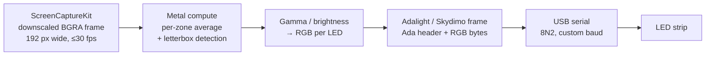

# Glowline

Native macOS menu-bar app that turns the LED strip behind your monitor into real-time ambient lighting. Works with Skydimo kits and Adalight-compatible controllers.

[](https://github.com/OWNER/REPO/actions/workflows/ci.yml)


## Demo


## Why

USB LED kits such as Skydimo ship no app for macOS on Apple Silicon. The open-source ambient-lighting tools that do run on a Mac are heavyweight general-purpose servers: they use a lot of resources and take a lot of setup for a single strip behind a monitor.

Glowline is the opposite: a small native Swift app with no dependencies. It lives in the menu bar, auto-detects the controller and uses about 1% CPU while it runs.

## Features

- **Real-time screen mirroring**: captures a display with ScreenCaptureKit (up to 60 fps, 30 by default) and maps its edges onto the strip.
- **GPU color averaging**: one Metal compute pass reduces every LED zone to a single color, and only one value per zone is read back to the CPU.
- **Letterbox detection**: black bars in movies are detected and skipped, so the top and bottom LEDs follow the picture rather than the bars.
- **Skydimo and standard Adalight protocols**: classic `Ada` header with checksum, or the fixed Skydimo header. Any baud rate (115200 to 2 000 000) is supported.
- **Auto-detection** of common USB-serial LED controllers: CH340/CH9102 (WCH), CP210x, FTDI, PL2303, Arduino and ESP32 native USB.
- **Flexible strip layout**: LED count per side, start corner, direction and edge sampling depth.
- **Live settings window**: brightness, gamma, color order and letterbox settings apply instantly and are saved automatically.
- **Self-healing**:
  - recovers from sleep/wake, USB re-enumeration and display reconnects without a relaunch;
  - a watchdog unblocks hung serial writes;
  - capture pauses while the controller is unplugged.
- **Menu-bar only**: no Dock icon; the status shows at a glance (💡 connected, 🌑 waiting for the controller).
- **Hardware diagnostics**: `--test-frame`, `--test-ends`, `--list-serial-devices`, `--list-displays`, `--dry-run`.

## Supported hardware

| Device | Connection | Status |
|---|---|---|
| Skydimo USB LED kit (CH340 controller, 156 LEDs) | USB, 115200 baud, fixed header | Tested |
| Other Skydimo kits | Same protocol, set your LED count per side | Expected to work |
| Adalight controllers (Arduino / ESP8266 / ESP32 + WS2812, SK6812, …) | USB-serial, any baud rate | Supported by protocol, not tested |

Requires macOS 13 Ventura or later. Release builds are universal (Apple Silicon and Intel); tested on Apple Silicon.

If your controller isn't auto-detected, run `--list-serial-devices` and set `serialPort` in Settings.

## Installation

### Download a release

1. Download `Glowline-<version>.zip` from [Releases](../../releases) and unzip it.
2. Move `Glowline.app` to `/Applications`.
3. The app is ad-hoc signed, not notarized. On first launch, right-click it and choose **Open**, or run:
   ```sh
   xattr -dr com.apple.quarantine /Applications/Glowline.app
   ```
4. Grant **Screen Recording** permission when asked (System Settings → Privacy & Security → Screen & System Audio Recording), then use **Restart** from the menu-bar icon.

### Build from source

Requirements: macOS 13+, Xcode 15.3+ or the Swift 5.10+ command-line toolchain.

```sh
git clone https://github.com/OWNER/REPO.git
cd REPO
swift test           # run the unit tests
./build-app.sh       # release build → Glowline.app (ad-hoc signed)
# UNIVERSAL=1 ./build-app.sh   # arm64 + x86_64 binary (needs full Xcode)
open Glowline.app
```

`build-app.sh` pins the code signature to the bundle identifier, so the Screen Recording permission survives rebuilds. For quick iteration, `swift run Glowline --help` works too, but macOS will ask for the permission again after every rebuild.

## Usage

1. Plug in the controller. The menu-bar icon turns 💡 once it is found, and capture starts automatically.
2. Open **Settings…** from the menu-bar icon and set the LED count per side.
3. To find out where LED #0 is and which way the strip runs:
   ```sh
   ./Glowline.app/Contents/MacOS/Glowline --test-ends
   ```
   Zone 0 lights red and the last zone blue. Set **Start corner** and **Clockwise** to match.
4. For a Skydimo kit, enable **Fixed Ada header** and use 115200 baud (see [`examples/skydimo-156-leds.json`](examples/skydimo-156-leds.json)).

Settings are stored in `~/.config/glowline/config.json`. A different file can be passed with `--config <path>`. Fields that change the capture stream or the serial port show a "restart required" banner; everything else applies live.

<details>
<summary>Command-line options</summary>

```
--config <path>          Path to JSON config (default: ~/.config/glowline/config.json, then ./config.json)
--dry-run                Don't open a serial port; capture and compute frames, logging a summary every 60 frames
--test-frame [r,g,b]     Send one solid-color frame to the configured serial port and exit
                         (no screen capture involved -- works without Screen Recording permission)
--test-ends              Lights zone index 0 red, the last zone blue, everything else dim
--list-displays          List capturable displays and exit
--list-serial-devices    List /dev/cu.* serial devices (with USB vendor/product IDs) and exit
--help                   Show this help
```
</details>

<details>
<summary>Configuration reference</summary>

| Key | Default | Description |
|---|---|---|
| `displayIndex` | `0` | Display to capture (see `--list-displays`) |
| `captureWidth` | `192` | Width the frame is downscaled to by ScreenCaptureKit |
| `targetFPS` | `30` | Maximum capture frame rate |
| `serialPort` | `null` | Fixed `/dev/cu.*` path; `null` = auto-detect |
| `baudRate` | `500000` | Serial speed (any value) |
| `zones.top/right/bottom/left` | `10/6/10/6` | LEDs per side |
| `zones.startCorner` | `topLeft` | Corner where LED #0 sits |
| `zones.clockwise` | `true` | Strip direction, viewed from the front |
| `zones.edgeDepthFraction` | `0.15` | How deep into the frame each edge zone samples |
| `gamma` / `brightness` | `1.0` / `1.0` | Color correction |
| `colorOrder` | `RGB` | Byte order on the wire (`RGB`, `GRB`, `BGR`, …) |
| `fixedAdaHeader` | `false` | Skydimo header format (see below) |
| `letterboxDetection` / `letterboxThreshold` | `true` / `0.06` | Black-bar detection |
</details>

## How it works



1. **Capture.** ScreenCaptureKit delivers the display already downscaled by the compositor (192×108 BGRA on a 16:9 display), so the app never touches a full-resolution image.
2. **Color averaging.** The pixel buffer is wrapped as a Metal texture with zero copies. One threadgroup per LED zone (64 threads) sums the zone's pixels and combines them with a shared-memory reduction; gamma and brightness are applied on the GPU.
3. **Letterbox detection.** A second kernel computes per-row brightness a few times per second. The detected content area is smoothed over time, so bars appearing or disappearing doesn't make the LEDs jump.
4. **Protocol.** The colors are packed into an Adalight frame: `"Ada"`, LED count, checksum, then 3 bytes per LED. Skydimo controllers use a variant header, `41 64 61 00 00 <LED count>`, with no checksum.
5. **Transport.** The serial port is opened in raw mode with 2 stop bits, and the speed is set through the `IOSSIOSPEED` ioctl, so any baud rate works. A dedicated queue always sends only the newest frame, so the strip never falls behind the screen. Each write is paced by `tcdrain` and guarded by a watchdog.
6. **Supervision.** Capture and serial each run under a retry supervisor (a Swift `actor`) that restarts them after sleep, unplugging or errors. A once-per-second heartbeat resends the last frame, so a static screen doesn't blank the strip.

**Performance** (Apple Silicon, 156-LED Skydimo kit, 115200 baud, measured with `ps` and the serial port's byte counter):

| Metric | Value |
|---|---|
| App CPU while capturing | ~1.1 % |
| Memory (RSS) | ~57 MB |
| Frames delivered to the strip | ~10 fps before the adaptive pacing fix, re-measurement pending |

At 115200 baud, a 156-LED frame (474 bytes) takes about 45 ms on the wire, so the link itself tops out at about 22 fps. After each frame the sender waits up to 50 ms for an acknowledgement byte. If the controller doesn't answer three frames in a row (Skydimo doesn't), it switches to a 5 ms gap instead, which lets the link run close to its limit. If an acknowledgement shows up later, the 50 ms wait comes back.

## Tech stack

- **Swift 5.10**, Swift Package Manager, no third-party dependencies
- **ScreenCaptureKit**: screen capture
- **Metal**: compute shaders for color averaging
- **IOKit** and POSIX `termios`: USB-serial discovery and I/O
- **AppKit** and **SwiftUI**: menu-bar item and settings window
- **Swift Concurrency** (`actor`, `async/await`) and Combine
- XCTest, `swift-format`, GitHub Actions

## Project structure

```
Sources/Glowline/
├── App/          entry point, CLI parsing, diagnostics
├── Capture/      ScreenCaptureKit stream + restart supervisor
├── Processing/   Metal zone averager and shaders
├── Protocol/     Adalight frame encoding, zone layout
├── Serial/       serial port, device discovery, reconnect supervisor
├── Support/      retry actor, lock wrapper, logging
└── UI/           menu bar, settings window and store
```

## Roadmap / Known issues

- [ ] Developer ID signing and notarization (releases are currently ad-hoc signed)
- [ ] Launch at login
- [ ] Multi-display / per-display layouts
- [ ] Color smoothing between frames
- [ ] In fixed-header (Skydimo) mode the LED count is sent as a single byte, so strips with more than 255 LEDs are not supported
- [ ] Changing capture, serial or zone settings requires an app restart (offered from the settings window)

## Acknowledgements

The Skydimo header format matches the one implemented in [Hyperion.ng](https://github.com/hyperion-project/hyperion.ng) (`LedDeviceSkydimo`) and was verified by observing the controller's serial traffic. No code, firmware or assets from Skydimo or Hyperion are included in this repository.

## Disclaimer

Unofficial project, not affiliated with or endorsed by Skydimo. "Skydimo" is used only to describe hardware compatibility. All trademarks belong to their respective owners.

## License

[MIT](LICENSE) © 2026 Roman Surkov
